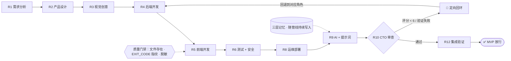

<div align="center">

# 🏭 OneMaker Pipeline

**AI 工程化交付系统 — 把完整工程团队的工序编进一条多 Agent 管线**

<sub>需求 → 设计 → 开发 → 验证 → 上线：角色隔离 · 质量门禁 · EXIT_CODE 指纹 · 定向回环 · 持久记忆</sub>

[](https://github.com/zw-onemaker-ai/onemaker-pipeline/actions/workflows/ci.yml)
[](LICENSE)


</div>

---

## 这是什么

当你让多个 AI Agent 协作交付一个产品时，瓶颈从来不是「代码能不能写出来」，而是**工序**：

- 谁先谁后？产出怎么传给下一个角色？
- 什么才算「完成」——Agent 说完成，就算完成吗？
- 出错了往哪里回退？中断了怎么恢复？上下文爆了怎么办？

**OneMaker Pipeline 把完整工程团队的 14 个角色编成一条有状态的交付管线，并把「验证」做进每一个交接点：不通过，不路由。**

它不是一个新的 Agent 编排框架——它是**跑在 Agent 之上的交付制度**：一份可以直接被 Claude Code 等编程 Agent 使用的协议集（角色提示词 + 质量门禁 + 记忆架构 + 调度规则）。

> 适合单人工程与极小团队场景：你 + Agent 团队，交付质量由系统保证，而不是靠运气。

## 一张图



## 14 个角色

| 角色 | 职责 | 关键产出 |
|------|------|---------|
| R1 需求分析 | 用户故事 + 验收标准 + 场景分类 | `docs/requirements.md` |
| R2 产品设计 | 功能清单 + MVP 边界 + 审计 R1 | `docs/product_spec.md` |
| R3 视觉创意 | 外部参考调研 + Mood Board 方向 | `docs/creative_brief.md` |
| R4 后端开发 | 可运行后端 + 健康检查 | `backend/` |
| R5 前端开发 | 五态完整界面 + 审计 R4 | `frontend/` |
| R6 测试 + 安全 | 测试金字塔 + 安全加固（直接修） | `tests/` |
| R8 运维部署 | 容器化 + 回滚方案 | `deploy/` |
| R9 AI + 提示词 | AI 集成 + 降级逻辑 + 成本 | `prompts/` |
| R10 CTO 审查 | 逐文件审查 + 五维评分 + 定向回环判定 | `CTO_REVIEW_REPORT.md` |
| R12 集成验证 | 验收脚本自动化 + MVP 放行 | `docs/mvp_validation.md` |
| R11 运营推广（可选） | 渠道策略 + 发布文案 | 内容资产 |
| R13 全局审计 | 跨角色系统性缺陷审计 | 审计报告 |
| R13 文案 | 客户面向文案改写 | 脱敏文案 |

## 核心机制

### 1. 三道验证闸门 + EXIT_CODE 指纹

每个角色的产出必须过闸门才能传给下游：

- **闸门① 文件存在性** — 声称写了的文件，磁盘上必须真的有、且非空
- **闸门② EXIT_CODE 指纹** — 所有 Bash 验证必须贴出退出码。**Agent 可以编话，编不了退出码**
- **闸门③ 文档脱敏** — 面向客户的产出不得含内部术语

### 2. 定向回环（不是盲目重跑）

CTO 审查不通过时，按问题类型**回退到对应角色**：Bug → R4/R5，架构 → R2，安全 → R6。回环超过 2 次自动升级管线医生诊断。

### 3. 三层记忆 + 防膨胀

`_index.json`（≤4KB，轻量索引）→ `projects/{name}.json`（≤8KB，项目全记忆）→ `sessions/`（≤10KB，归档流水）。
每层有硬上限、自动裁剪，**裁剪前先快照到 `archive/`**（可从快照恢复）。启动时 5 项健康检查。

### 4. 三级上下文预算

上游产出累计超过 12KB → 自动降级为「摘要优先、按需深读」；超过 20KB → 仅消费摘要。防止模型注意力被长上下文稀释。

### 5. 反幻觉消费验证

每个角色启动第一步：验证上游文件**存在 + 非空 + 可读 + 语法合法**。断链即暂停管线，输出缺失清单，而不是带着幻觉继续往下跑。

### 6. 工程模式（已有项目 6 步迭代）

已上线项目不再走全管线，切换为 6 步迭代循环：健康检查 → 状态快照 → 依赖分析 → 修改 → 回归验证 → 通知 + 记忆。

## 快速开始（5 分钟 · 零依赖）

```bash
git clone https://github.com/zw-onemaker-ai/onemaker-pipeline
cd onemaker-pipeline

# ① 质量门禁演示：看三道闸门如何拦截「假装完成」的产出
python3 examples/01_quality_gate/demo.py

# ② 记忆守卫：三层记忆的大小门禁 + JSON 校验（含违规样例拦截自检）
python3 examples/02_memory_guard/check.py memory --self-test

# ③ 管线漫游：跟着一条完整管线走完 R1 → R12（含一次定向回环）
python3 examples/03_pipeline_walkthrough/run.py
```

然后两种用法：

| 用法 | 怎么做 |
|------|--------|
| **方法参考** | 先读 [`pipeline/agent_core.md`](pipeline/agent_core.md)（核心规章），再按需读角色定义 |
| **直接开工** | 把你自己的项目放进 `projects/`，用 Claude Code 打开本目录——`CLAUDE.md` 就是协议入口 |

## 实战验证

- **[AgentGate](https://github.com/zw-onemaker-ai/agent_gate)**（本管线的产出之一）：多 Agent 管线可靠性框架——127 项自动化测试、CI 三版本矩阵、已发布 Release，解决「Agent 产出不可信」问题
- 多个企业级交付项目（存量系统接入、AI 客服自动化等，已脱敏）
- 管线自身版本迭代 4.x → 每个机制都来自真实交付中的翻车与修复

## 与相邻方案的定位

| 方案 | 关注点 | 与本管线的关系 |
|------|--------|--------------|
| LangChain / CrewAI / AutoGen | 怎么把 Agent 灵活串联（编排框架） | 互补——本管线是**制度层**：定义工序、门禁、记忆与回退，可架在其上 |
| [AgentGate](https://github.com/zw-onemaker-ai/agent_gate)（同作者） | 单个产出的可信性（验证层） | 同级不同向——AgentGate 管「每个产出可信」，本管线管「整条交付线可控」 |
| 单 Prompt / 一次性生成 | 生成速度 | 本管线用角色分工 + 审计链换「可交付质量」 |

## 目录结构

```
pipeline/                 协议核心
├── agent_core.md         核心规章（记忆/验证/审计/安全 全协议）
├── 00_orchestrator.md    调度引擎（门禁裁决 / 上下文预算 / 回环路由）
├── engineering_mode.md   工程模式（已有项目 6 步迭代）
├── EXECUTION_MODE.md     执行标准（验证拦截 / 场景策略 / 安全门禁链）
├── roles/                R1-R12 + R13 角色提示词（14 个）
└── tools/                validate.sh 管线验证器 · CPOO · Pipeline Doctor
examples/                 3 个零依赖演示（门禁 / 记忆 / 漫游）
memory/                   三层记忆（模板已就位，开箱即用）
plans/                    计划层（计划先行，未规划不动工）
projects/                 项目产出目录
```

## 设计哲学

- **执行优先于描述** — 产出必须是实际产物，不是「建议」
- **自评 ≠ 真相** — 角色说「我做完了」不算数，外部验证才算数
- **验证高于信任** — 默认一切产出不可信，验证过才放行
- **记忆是资产** — 写入「下次恢复需要知道的」，不是「发生了什么」
- **质量优先于速度** — HIGH 级问题清零才允许放行 MVP

## 诚实局限

- 为**单机工程场景**设计（单人的算力与注意力边界内）；不是分布式多机编排
- 记忆层是**文件式**（简单、可审计，适合个人与小团队；不是数据库）
- 角色提示词针对 Claude / Qwen / DeepSeek 等做过实战调优，更换模型需要回归验证
- 管线会**主动拦截**质量不达标的产出——习惯「能跑就行」的团队会觉得它慢

## License

[MIT](LICENSE) · 由 [zw-onemaker-ai](https://github.com/zw-onemaker-ai) 维护
相关项目：[AgentGate — 多 Agent 管线可靠性框架](https://github.com/zw-onemaker-ai/agent_gate)
